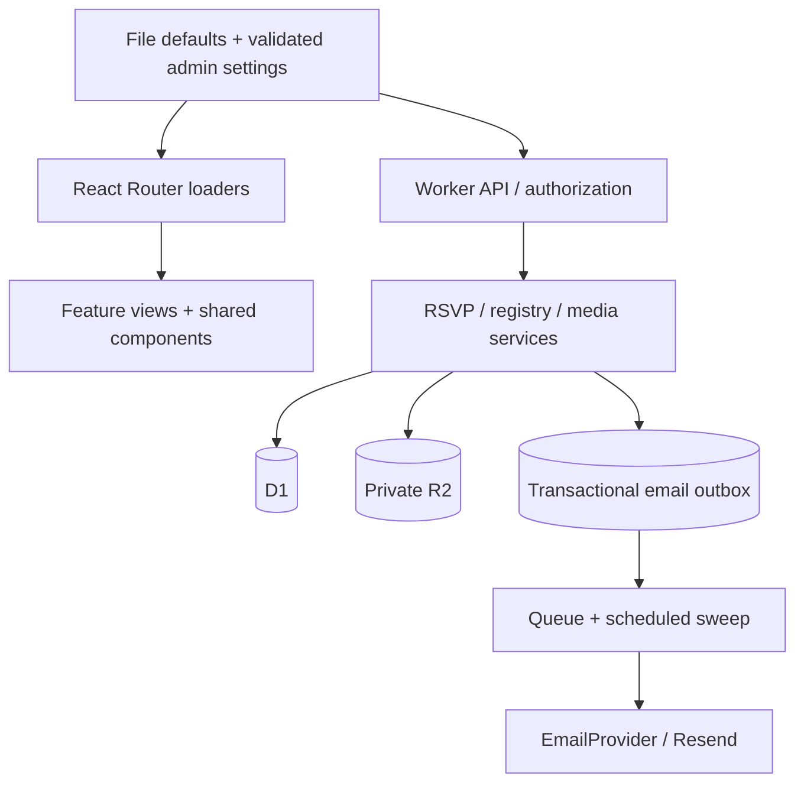

# Architecture and extension points

Open Wedding is a single-installation template. Each couple owns its own deployment and data. It is not a multi-tenant wedding SaaS. This keeps accounts, billing and configuration understandable for a small event.

## Opinionated choices

| Concern              | Choice                                                    | Reason                                                                                       |
| -------------------- | --------------------------------------------------------- | -------------------------------------------------------------------------------------------- |
| Web application      | React Router framework mode, React, TypeScript            | Server rendering, familiar React components, typed route data and direct Cloudflare support. |
| Runtime              | Cloudflare Workers + Vite plugin                          | One deployment for pages, APIs, queue consumer and scheduled recovery.                       |
| Database             | D1 with versioned SQL migrations                          | Small relational guest data; atomic batches and database-enforced constraints.               |
| Admin authentication | Better Auth + Drizzle D1 adapter                          | Established password/session handling; no separate auth-service account.                     |
| Guest authentication | Hashed random invitation codes and opaque cookie sessions | Household RSVP without accounts; no public guest directory.                                  |
| Email                | Resend + React Email rendering                            | Sender verification, HTML/text messages and provider idempotency.                            |
| Reliability          | SQL outbox + Cloudflare Queues + cron                     | RSVP commits do not depend on a mail provider's uptime.                                      |
| Media                | Private R2 + Uppy                                         | Controlled uploads, progress UI and host moderation without an extra media-service signup.   |
| Localization         | i18next + localized configuration records                 | Both interface and wedding content support English and Mandarin.                             |
| Styling              | Tailwind, shared UI primitives, CSS theme tokens          | Presentation can change without touching guest or RSVP rules.                                |
| Verification         | Vitest + Miniflare D1/R2                                  | Real SQLite constraints and race behavior instead of mocks that mirror the implementation.   |

## Boundaries

- `content/wedding.json`: fictional content defaults. No secrets or guest records belong here.
- `app/config/schema.ts`: configuration contract, translation requirements, time zone and URL validation.
- `app/config/modules.ts`: module metadata and feature gates shared by navigation and server services.
- `app/features/`: independent guest views for home, timeline, travel, FAQ, RSVP, seating, registry and memories.
- `app/components/`: shared controls, invitation redemption, content editing and uploader integration.
- `app/routes/`: composition and server data loading; the host dashboard is separate from guest views.
- `app/domain/`: behavior and validation for RSVP, gifts, media and calendar output.
- `app/platform/`: Cloudflare context, auth, persistence access, HTTP boundaries, security helpers and email adapter.
- `workers/app.ts`: thin runtime entry point for fetch, queue and scheduled events.
- `migrations/`: authoritative database history; Drizzle describes Better Auth's tables only.
- `scripts/`: local setup and account-specific deployment helpers.
- `tests/`: access, atomic persistence, constraints and reliability checks against local D1.

Presentation modules receive a common `FeatureViewProps` contract. Providers are explicit at useful boundaries: `EmailProvider` can be replaced for tests or another sender. D1 and R2 remain deliberate Cloudflare integrations; changing the hosting platform requires new persistence/runtime implementations. The template does not claim to have a turnkey Docker or another-provider deployment.

## State and privacy rules

An event being public does not make every household invited to it. Public visibility and RSVP authorization are different concerns. Only the explicit household/event relationship authorizes a response. Every RSVP submission contains the complete set of that household's invited RSVP events and guests.

Optimistic household revisions prevent one person from overwriting a newer reply from another. A submission ID deduplicates retries. An atomic D1 batch records answers, the revision and the email outbox together. Queue publication is recoverable from the stored outbox.

Seat constraints require accepted attendance and reject capacity overflow in SQLite. The guest loader filters the household and release time, then returns table labels without other households' names.

Gift reservations use one conditional SQL write for stock and household deduplication. Holds expire after 48 hours; a guest can mark a gift purchased or release it. Funds and other registries use external links rather than collecting money in the application.

Upload allocation reserves household quota before streaming. The upload endpoint binds the object to the authenticated household, checks its declared size/type and initial file signature, and uses a fixed-length stream. Only approved objects are guest-readable after the gallery release. Abandoned allocations are cleaned by the scheduled sweep.

## Adding a feature

1. Extend the validated configuration contract and example translations.
2. Add module metadata/feature gating in `app/config/modules.ts`.
3. Put its view in `app/features/` and compose it in the guest route.
4. Add server checks before reads or writes. Hiding navigation is insufficient.
5. Add a migration for new relationships or constraints.
6. Test authorization, concurrency or data boundaries introduced by the feature.
7. Update configuration and host-facing documentation.

For another language, add the full interface dictionary, schema locale enum, uploader locale, invitation/announcement selectors, date support and calendar routing. A partial translation should fail validation rather than silently ship missing content.
